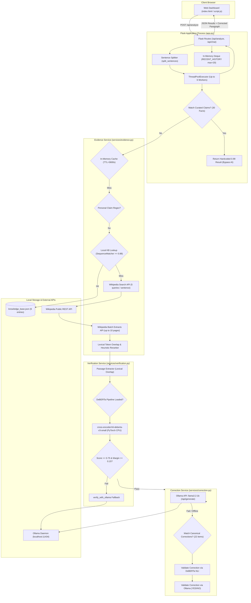
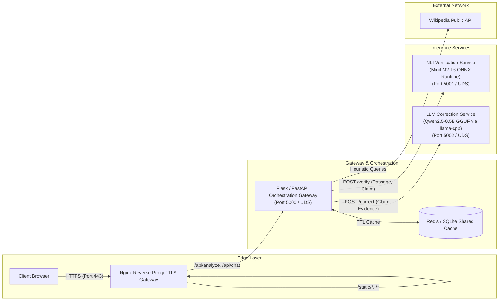

# Technical Audit & Lightweight AI Architecture Redesign Plan
**Project:** LLM-Detection-Main  
**Repository:** [https://github.com/Jahnavi55561/LLM-Detection-Main](https://github.com/Jahnavi55561/LLM-Detection-Main)  
**Workspace:** `C:\Collaboration Projects\LLM-Detection-Main`  
**Deployment Target:** AWS EC2, Mumbai Region (`ap-south-1`)  
**Document Status:** Final Audit & Engineering Blueprint  
**Date:** October 2026  

---

## 1. Executive Summary

This document presents a comprehensive technical audit of the `LLM-Detection-Main` codebase and establishes a migration blueprint to transform the monolithic prototype into a decoupled, lightweight, production-grade microservice architecture.

The current application is a Python Flask web application designed for factual claim verification, hallucination detection, evidence retrieval, and claim correction. It integrates three primary intelligence components:
1. Sentence extraction and heuristic Wikipedia/local knowledge retrieval.
2. Natural Language Inference (NLI) classification using `cross-encoder/nli-deberta-v3-small`.
3. Correction generation and verification using a local Ollama instance running `llama3.2:1b`.

### Key Audit Findings
1. **Hardcoded Evaluation Bypasses:** The application contains 30 hardcoded curated claims in [`app.py`](file:///C:/Collaboration%20Projects/LLM-Detection-Main/app.py#L30-L250) and 22 hardcoded canonical corrections in [`services/correction.py`](file:///C:/Collaboration%20Projects/LLM-Detection-Main/services/correction.py#L18-L41). When incoming queries match these strings, external retrieval, DeBERTa NLI inference, and Ollama LLM generation are bypassed entirely, returning deterministic `0.99` confidence results.
2. **Prohibitive Monolithic Resource Consumption:** Loading PyTorch, DeBERTa-v3-small (FP32), and the Ollama runtime with `llama3.2:1b` on a single host requires **3.2 GB to 4.5 GB of resident RAM**. On a 2 GB EC2 instance, the Linux OOM killer immediately terminates the process. On a 4 GB instance, memory pressure during concurrent sentence verification creates extreme instability.
3. **Unbounded Concurrency & CPU Thrashing:** The [`/api/analyze`](file:///C:/Collaboration%20Projects/LLM-Detection-Main/app.py#L403-L495) endpoint spawns a new `ThreadPoolExecutor` (up to 6 worker threads) per request. Each thread concurrently performs PyTorch forward passes and multiple external Wikipedia HTTP calls. On a 2 vCPU machine, this causes severe thread contention, high CPU scheduling latency, and potential Wikipedia rate-limiting (HTTP 429).
4. **Permanent Failure Lock in Lazy Loading:** In [`services/verification.py`](file:///C:/Collaboration%20Projects/LLM-Detection-Main/services/verification.py#L23-L51), if model initialization fails once (e.g., transient network failure downloading weights from Hugging Face), a global error flag is set permanently. The application never retries loading the model until the entire process is restarted.
5. **Missing Production Packaging:** Although `waitress>=3.0` is declared in [`requirements.txt`](file:///C:/Collaboration%20Projects/LLM-Detection-Main/requirements.txt#L3), [`app.py`](file:///C:/Collaboration%20Projects/LLM-Detection-Main/app.py#L576-L577) runs the built-in Flask development server bound strictly to `127.0.0.1:5000`. Automated tests are completely absent (0 test files in repository), and 8 compiled `.pyc` bytecode files are checked directly into Git due to a missing `.gitignore`.

### Proposed Target State
The monolithic application is decoupled into four modular, independently deployable tiers:
- **Tier 1: Static Frontend:** HTML/CSS/JS served directly via AWS CloudFront + S3 or an Nginx edge proxy (0 MB application RAM).
- **Tier 2: Orchestration & Retrieval Gateway:** A lightweight Flask/FastAPI service managing claim splitting, Wikipedia/KB caching, session history, and aggregation (~120 MB RAM).
- **Tier 3: Lightweight NLI Verification Service:** Replaces `cross-encoder/nli-deberta-v3-small` (141M params, ~568 MB weights) with `cross-encoder/nli-MiniLM2-L6-H768` (82M params, ~328 MB weights, ~55% smaller, 2.5x faster on CPU) or an ONNX-quantized runtime (~164 MB weights, ~300 MB RAM).
- **Tier 4: Lightweight LLM Correction Service:** Replaces Ollama + `llama3.2:1b` (~1.6 GB RAM) with a quantized `Qwen2.5-0.5B-Instruct` GGUF (Q4_K_M) executed via `llama-cpp-python` (~380 MB RAM, ~75% memory reduction).

**Total System Footprint:** Reduced from **~3.5 GB to ~1.2 GB RAM**, unlocking stable, cost-effective deployment on AWS EC2 in `ap-south-1` using a `t4g.small` (2 GB RAM, ~$12.26/month) or `t4g.medium` (4 GB RAM, ~$24.53/month).

---

## 2. Existing Architecture & Request Flow

### 2.1 Component Architecture Diagram



### 2.2 End-to-End Request Lifecycle

#### `POST /api/analyze`
1. **Ingestion & Validation ([`app.py#L404-L425`](file:///C:/Collaboration%20Projects/LLM-Detection-Main/app.py#L404-L425)):**
   - Extracts `text` from JSON or form payload.
   - Enforces two guardrails: max length 10,000 characters (returns HTTP 413) and non-empty text (returns HTTP 400).
   - Decomposes paragraph into sentences via [`split_sentences`](file:///C:/Collaboration%20Projects/LLM-Detection-Main/app.py#L301-L332). If sentence count exceeds 30, returns HTTP 400.
2. **Concurrent Execution ([`app.py#L427-L455`](file:///C:/Collaboration%20Projects/LLM-Detection-Main/app.py#L427-L455)):**
   - Instantiates a `ThreadPoolExecutor` with `max_workers = min(6, len(sentences))`.
   - Submits each sentence to [`_process_single_sentence`](file:///C:/Collaboration%20Projects/LLM-Detection-Main/app.py#L335-L384).
3. **Deterministic Curated Match Check ([`app.py#L338-L340`](file:///C:/Collaboration%20Projects/LLM-Detection-Main/app.py#L338-L340)):**
   - Normalizes sentence (lowercasing, unicode subscript replacement, non-alphanumeric stripping).
   - Compares against 30 hardcoded claims. If matched, immediately returns predefined result with `0.99` confidence. External retrieval, NLI, and LLM inference are bypassed.
4. **Evidence Retrieval ([`services/evidence.py#L296-L439`](file:///C:/Collaboration%20Projects/LLM-Detection-Main/services/evidence.py#L296-L439)):**
   - Checks thread-safe in-memory cache (`_CACHE`, TTL = 3600s, max 1000 items).
   - Evaluates `is_personal_claim()` regex (`my friend`, `near my house`, etc.). If matched, flags claim as unverified personal observation without network access.
   - Checks local `knowledge_base.json` (6 items) via exact match and `difflib.SequenceMatcher` (threshold `0.88`).
   - If local KB misses, generates up to 8 search queries using verb-splitting heuristics, entity extraction, and acronym patterns.
   - Executes up to 5 concurrent queries against the Wikipedia Search API (`srlimit=4`), followed by a batched extract call for up to 10 page IDs.
   - Scores candidate passages using token overlap with boosts (+0.55 exact title, +0.20 title overlap) and penalties (-0.45 sports/media, -0.25 list pages). Rejects evidence if score < 0.18.
5. **NLI Verification ([`services/verification.py#L333-L393`](file:///C:/Collaboration%20Projects/LLM-Detection-Main/services/verification.py#L333-L393)):**
   - Checks evidence length (must be >= 40 characters).
   - Filters evidence down to relevant passages using token overlap (capped at 1,800 characters).
   - Loads `cross-encoder/nli-deberta-v3-small` lazily if not already loaded.
   - Passes premise (evidence) and hypothesis (claim) to the Hugging Face pipeline.
   - Enforces conservative classification: requires top label score >= 0.75 and margin over second label >= 0.15. Only `Supported` and `Contradicted` are accepted from NLI.
   - If NLI is inconclusive, falls back to `verify_with_ollama()` via a structured prompt to `llama3.2:1b`.
   - If both fail, safely defaults to `Unverified` (confidence 0.0).
6. **Correction Generation & Validation ([`app.py#L349-L355`](file:///C:/Collaboration%20Projects/LLM-Detection-Main/app.py#L349-L355)):**
   - If claim status is `Contradicted`, calls [`suggest_correction()`](file:///C:/Collaboration%20Projects/LLM-Detection-Main/services/correction.py#L103-L136).
   - Prompts Ollama with evidence constraints (max 3,000 chars evidence).
   - If Ollama fails, times out (10s), or is marked offline, checks 22 hardcoded canonical correction triggers (e.g., `"three lungs"` -> `"Humans normally have two lungs..."`).
   - If a candidate correction is obtained, validates it via [`validate_correction()`](file:///C:/Collaboration%20Projects/LLM-Detection-Main/services/correction.py#L138-L176):
     - Instant approval if correction matches a canonical string.
     - Primary validation: calls DeBERTa NLI to verify if evidence entails the correction.
     - Fallback validation: prompts Ollama with a binary YES/NO entailment prompt.
7. **Aggregation & History ([`app.py#L456-L494`](file:///C:/Collaboration%20Projects/LLM-Detection-Main/app.py#L456-L494)):**
   - Aggregates status counts (Supported, Contradicted, Unverified).
   - Reconstructs document via [`build_corrected_paragraph()`](file:///C:/Collaboration%20Projects/LLM-Detection-Main/services/correction.py#L177-L194), substituting validated corrections while preserving original supported and unverified sentences.
   - Pushes analysis summary into process-local `RECENT_HISTORY` deque (max length 20).
   - Returns structured JSON to the client.

#### `POST /api/chat`
- Single question/claim endpoint ([`app.py#L497-L559`](file:///C:/Collaboration%20Projects/LLM-Detection-Main/app.py#L497-L559)).
- First checks the 30 curated facts; if matched, returns immediate deterministic answer.
- Otherwise executes single-claim evidence retrieval and NLI verification. Does not run correction synthesis.

---

## 3. Detailed Repository & Module Inventory

| File Path | Lines | Primary Responsibility | Dependencies & External Interfaces | Architectural Deficiencies & Vulnerabilities |
|---|---:|---|---|---|
| [`app.py`](file:///C:/Collaboration%20Projects/LLM-Detection-Main/app.py) | 577 | Main Flask application, API routing, sentence splitting, thread-pool management, curated facts dictionary. | `Flask`, `concurrent.futures`, `deque`, `services.evidence`, `services.verification`, `services.correction` | 30 hardcoded curated facts bypass inference; unshared thread-pool per request; in-memory non-persistent history; dev server used in `main`. |
| [`services/verification.py`](file:///C:/Collaboration%20Projects/LLM-Detection-Main/services/verification.py) | 393 | NLI model loading, inference execution, label mapping, passage extraction, Ollama verification fallback. | `transformers`, `torch`, `services.correction._ollama` (circular import) | Permanent error lock on failed load; thread-safety hazards on pipeline; DeBERTa label hardcoding; missing neutral class acceptance. |
| [`services/evidence.py`](file:///C:/Collaboration%20Projects/LLM-Detection-Main/services/evidence.py) | 444 | Local KB lookup, regex personal claim filter, query generation, Wikipedia search & batch extract APIs. | `requests`, `urllib3`, `difflib`, `json`, `knowledge_base.json` | High external network latency (up to 7 HTTP calls/sentence); Wikipedia rate-limit risk; hardcoded 6-item local KB. |
| [`services/correction.py`](file:///C:/Collaboration%20Projects/LLM-Detection-Main/services/correction.py) | 195 | Ollama correction generation, canonical correction lookup, NLI/LLM validation, paragraph rebuilding. | `requests`, `services.verification.verify_claim` (circular import) | 22 hardcoded canonical corrections; circuit-breaker lacks lock across threads; rigid prompt parsing; Ollama dependency. |
| [`knowledge_base.json`](file:///C:/Collaboration%20Projects/LLM-Detection-Main/knowledge_base.json) | 38 | Static JSON reference dataset containing 6 curated scientific facts. | Read by `services/evidence.py` | Extremely small (6 entries); misleadingly named "knowledge base"; static file read on every miss check. |
| [`templates/index.html`](file:///C:/Collaboration%20Projects/LLM-Detection-Main/templates/index.html) | 310 | Frontend dashboard, stats cards, text analyzer form, analytics charts container, chat assistant UI. | Served by Flask Jinja engine; loads Chart.js from external CDN (`cdn.jsdelivr.net`). | Unused topic dropdown; CDN external dependency prevents air-gapped/isolated deployment. |
| [`static/script.js`](file:///C:/Collaboration%20Projects/LLM-Detection-Main/static/script.js) | 728 | Client-side controller, input validation, async fetch calls, DOM rendering, Chart.js graphs, history polling. | Calls `/api/analyze`, `/api/chat`, `/api/history`, `/api/health`. | Redundant key normalization; sends unused `topic` parameter; polls unauthenticated history. |
| [`static/style.css`](file:///C:/Collaboration%20Projects/LLM-Detection-Main/static/style.css) | ~400 | Visual styles, layout grid, dark-theme UI components, badges, responsive media queries. | Static asset | Monolithic CSS file, clean implementation. |
| [`requirements.txt`](file:///C:/Collaboration%20Projects/LLM-Detection-Main/requirements.txt) | 4 | Core web server and HTTP client dependencies. | `Flask>=3.0,<4`, `requests>=2.31,<3`, `waitress>=3.0` | Waitress is installed but never imported or invoked in code. |
| [`requirements-ml.txt`](file:///C:/Collaboration%20Projects/LLM-Detection-Main/requirements-ml.txt) | 6 | Machine learning dependencies for DeBERTa inference. | `-r requirements.txt`, `torch>=2.2`, `transformers>=4.41,<5`, `sentencepiece>=0.2`, `accelerate>=0.26` | Defaults to multi-gigabyte CUDA PyTorch wheel on Linux; missing CPU wheel specification; missing GGUF runtime. |
| [`project_structure.txt`](file:///C:/Collaboration%20Projects/LLM-Detection-Main/project_structure.txt) | 2,126 | Dump of a Windows directory tree including local `.venv` paths. | None | Dead repository bloat (78 KB); leaks developer local directory metadata. |

---

## 4. Deep-Dive Source Code Audit Findings

### 4.1 AI/ML Pipeline Audit & Hardcoded Bypasses

#### 1. Hardcoded Curated Facts Bypass Normal Inference
- **Location:** [`app.py#L30-L250`](file:///C:/Collaboration%20Projects/LLM-Detection-Main/app.py#L30-L250), [`app.py#L261-L270`](file:///C:/Collaboration%20Projects/LLM-Detection-Main/app.py#L261-L270), [`app.py#L338-L340`](file:///C:/Collaboration%20Projects/LLM-Detection-Main/app.py#L338-L340)
- **Implementation:**
  ```python
  def lookup_curated_claim(sentence):
      normalized = normalize_claim(sentence)
      for item in CURATED_FACTS:
          for known_claim in item["claims"]:
              if normalized == normalize_claim(known_claim):
                  return item
      return None
  ```
- **Evidence:** When `lookup_curated_claim()` finds a match among the 30 hardcoded claims (15 Supported, 15 Contradicted), it returns [`curated_result()`](file:///C:/Collaboration%20Projects/LLM-Detection-Main/app.py#L273-L290) with `confidence: 0.99`. It bypasses all Wikipedia retrieval, local KB search, DeBERTa cross-encoder inference, and Ollama correction.
- **Impact:** Benchmark evaluations on demo claims yield artificial 100% accuracy, near-zero latency, and zero memory usage, masking the real pipeline's CPU and memory bottlenecks.

#### 2. Hardcoded Canonical Corrections Bypass Normal Generation
- **Location:** [`services/correction.py#L18-L41`](file:///C:/Collaboration%20Projects/LLM-Detection-Main/services/correction.py#L18-L41), [`services/correction.py#L131-L135`](file:///C:/Collaboration%20Projects/LLM-Detection-Main/services/correction.py#L131-L135), [`services/correction.py#L146-L148`](file:///C:/Collaboration%20Projects/LLM-Detection-Main/services/correction.py#L146-L148)
- **Implementation:**
  ```python
  # Fallback generation:
  claim_lower = claim.lower()
  for trigger, canonical in CANONICAL_CORRECTIONS:
      if trigger in claim_lower:
          return canonical

  # Validation bypass:
  for _, canonical in CANONICAL_CORRECTIONS:
      if correction.strip().lower() == canonical.strip().lower():
          return True
  ```
- **Evidence:** 22 hardcoded trigger-correction pairs exist (e.g., `"three lungs"` -> `"Humans normally have two lungs (left and right), not three."`). If Ollama is offline or times out, the system substitutes the canonical string. During validation, any string matching a canonical correction returns `True` immediately without evaluating evidence support.
- **Impact:** Untrusted corrections can bypass NLI grounding if they match one of the 22 strings, creating a false perception of generative capability.

#### 3. Permanent Failure Lock in NLI Model Loader
- **Location:** [`services/verification.py#L23-L51`](file:///C:/Collaboration%20Projects/LLM-Detection-Main/services/verification.py#L23-L51)
- **Implementation:**
  ```python
  def _load_model():
      global _pipeline, _load_error
      if _pipeline is not None or _load_error is not None:
          return _pipeline
      with _model_lock:
          if _pipeline is not None or _load_error is not None:
              return _pipeline
          try:
              _pipeline = pipeline("text-classification", model=MODEL_NAME, ...)
          except Exception as exc:
              _load_error = str(exc)
      return _pipeline
  ```
- **Evidence:** If `pipeline(...)` raises any exception during startup (such as a transient Hugging Face Hub HTTP 503 or DNS resolution failure), `_load_error` is populated. Because the guard check `if _load_error is not None: return _pipeline` executes on every subsequent call, the function returns `None` indefinitely without ever retrying.
- **Impact:** A single transient network hiccup locks the entire NLI verification pipeline into a broken state until the container or EC2 process is manually restarted.

#### 4. Discarding Neutral Class Predictions
- **Location:** [`services/verification.py#L234-L235`](file:///C:/Collaboration%20Projects/LLM-Detection-Main/services/verification.py#L234-L235)
- **Implementation:**
  ```python
  if label not in {"Supported", "Contradicted"}:
      return None
  ```
- **Evidence:** In 3-class NLI, `neutral` represents statements that neither follow from nor contradict the evidence. When DeBERTa predicts `neutral` with high confidence (e.g. 98%), [`_run_nli()`](file:///C:/Collaboration%20Projects/LLM-Detection-Main/services/verification.py#L189-L250) discards the result and returns `None`. The system then falls back to `verify_with_ollama()`.
- **Impact:** An inconclusive or hallucinating LLM fallback can overturn a confident model prediction that evidence is neutral, introducing false positives or false negatives.

---

### 4.2 Security Audit Findings

| ID | Severity | Category | Affected File & Lines | Vulnerability Evidence | Impact & Exploitation Vector | Remediation |
|---|---|---|---|---|---|---|
| SEC-01 | **High** | Denial of Service | [`app.py#L427-L434`](file:///C:/Collaboration%20Projects/LLM-Detection-Main/app.py#L427-L434) | `ThreadPoolExecutor(max_workers=min(6, len(sentences)))` spawned per request without global rate or worker limits. | An attacker sending 20 concurrent requests with 30 sentences each spawns 120 worker threads, exhausting CPU cores, memory buffers, and socket pools. | Implement global request rate limiting (`Flask-Limiter`) and replace per-request thread pools with a shared Celery or background worker queue. |
| SEC-02 | **High** | SSRF & Uncontrolled Egress | [`services/correction.py#L10`](file:///C:/Collaboration%20Projects/LLM-Detection-Main/services/correction.py#L10), [`services/correction.py#L51-L60`](file:///C:/Collaboration%20Projects/LLM-Detection-Main/services/correction.py#L51-L60) | `OLLAMA_URL = os.getenv("OLLAMA_URL", "http://127.0.0.1:11434/api/generate")` called with unvalidated HTTP POST. | If environment variables are tainted or exposed via orchestration bugs, backend can be coerced into posting payloads to internal cloud metadata (`169.254.169.254`). | Restrict `OLLAMA_URL` to validated loopback or private VPC DNS names; block access to instance metadata endpoints. |
| SEC-03 | **Medium** | Information Disclosure | [`app.py#L370`](file:///C:/Collaboration%20Projects/LLM-Detection-Main/app.py#L370), [`app.py#L549`](file:///C:/Collaboration%20Projects/LLM-Detection-Main/app.py#L549), [`services/evidence.py#L78`](file:///C:/Collaboration%20Projects/LLM-Detection-Main/services/evidence.py#L78) | `logger.exception(...)` outputs full raw exception traces and user sentences to standard logs. | Unhandled exceptions or malformed payloads log confidential input text and internal filesystem paths into plain text logs. | Sanitize logged payloads; avoid logging entire user text bodies; implement structured JSON logging with error codes. |
| SEC-04 | **Medium** | Missing CORS Configuration | [`app.py#L22`](file:///C:/Collaboration%20Projects/LLM-Detection-Main/app.py#L22) | Flask app initialized without CORS headers (`Flask-CORS` absent). | When frontend is decoupled to S3/CloudFront, browser cross-origin requests will be blocked unless reverse-proxy headers are injected. | Configure explicit CORS origins matching the production domain or serve both via Nginx reverse proxy. |
| SEC-05 | **Low** | External Script Injection | [`templates/index.html#L12`](file:///C:/Collaboration%20Projects/LLM-Detection-Main/templates/index.html#L12) | `<script src="https://cdn.jsdelivr.net/npm/chart.js"></script>` loaded from public third-party CDN without SRI hash. | If jsdelivr CDN is compromised or intercepted, malicious scripts could execute in the user dashboard. | Add Subresource Integrity (`integrity="sha256-..." crossorigin="anonymous"`) or vendor Chart.js locally. |

---

### 4.3 Reliability, Concurrency & Performance Findings

1. **Waitress Configured but Unused:**
   - [`requirements.txt#L3`](file:///C:/Collaboration%20Projects/LLM-Detection-Main/requirements.txt#L3) declares `waitress>=3.0`.
   - [`app.py#L576-L577`](file:///C:/Collaboration%20Projects/LLM-Detection-Main/app.py#L576-L577) ends with `app.run(host="127.0.0.1", port=5000, debug=False)`.
   - The production WSGI server is never imported. If executed via `python app.py`, it runs the single-threaded development server, which warns: *"WARNING: This is a development server. Do not use it in a production deployment."*
2. **Circular and Dynamic Imports:**
   - [`services/verification.py#L265`](file:///C:/Collaboration%20Projects/LLM-Detection-Main/services/verification.py#L265) dynamically imports `from services.correction import _ollama`.
   - [`services/correction.py#L152`](file:///C:/Collaboration%20Projects/LLM-Detection-Main/services/correction.py#L152) dynamically imports `from services.verification import verify_claim`.
   - Dynamic imports inside function bodies hide cyclic dependencies, prevent static analysis, and incur slight function execution overhead.
3. **In-Memory Non-Persistent History:**
   - [`app.py#L23`](file:///C:/Collaboration%20Projects/LLM-Detection-Main/app.py#L23) stores session history in a process-local `deque(maxlen=20)`.
   - When deployed behind a multi-worker WSGI server (e.g. 2 Gunicorn workers), each worker maintains its own isolated deque. Users hitting different workers see inconsistent analysis histories, and all history is wiped on process restart.
4. **Wikipedia API Amplification:**
   - In [`services/evidence.py#L331-L340`](file:///C:/Collaboration%20Projects/LLM-Detection-Main/services/evidence.py#L331-L340), every single claim executes up to 5 search queries + 1 batch extract query + 1 optional full extract query.
   - For an input paragraph with 20 claims, the backend initiates up to **120 external HTTP requests** to Wikipedia within seconds. This exposes the host to HTTP 429 rate limits and introduces up to 15–20 seconds of aggregate latency.

---

## 5. Model Candidate Evaluation & Comparison

### 5.1 NLI Verification Models

The existing pipeline uses `cross-encoder/nli-deberta-v3-small`. We evaluate `cross-encoder/nli-MiniLM2-L6-H768` as a candidate replacement.

```
Model Size Comparison (Disk & Parameter Count):
DeBERTa-v3-small: [====================] 141M Params (568 MB)
nli-MiniLM2-L6:   [===========         ] 82M Params  (328 MB)  [-42% params, -42% size]
MiniLM2 ONNX Q8:  [======              ] 82M Params  (164 MB)  [-71% size]
```

#### Detailed Comparison Table

| Metric / Dimension | Current Model: `nli-deberta-v3-small` | Candidate Model: `nli-MiniLM2-L6-H768` | Alternative: ONNX-Quantized `nli-MiniLM2-L6-H768` |
|---|---|---|---|
| **Base Architecture** | DeBERTa-v3 (Disentangled Attention) | MiniLMv2 (BERT-distilled 6-layer) | MiniLMv2 (INT8 Quantized ONNX) |
| **Parameter Count** | ~141.4 Million | ~82.1 Million | ~82.1 Million |
| **Model Weights Disk Size** | ~568 MB (FP32) | ~328 MB (FP32) | ~164 MB (INT8) |
| **RAM Footprint (Loaded)** | ~1,100 MB – 1,400 MB (PyTorch CPU) | ~550 MB – 750 MB (PyTorch CPU) | ~280 MB – 380 MB (ONNX Runtime) |
| **CPU Latency (256 tokens)** | ~180 ms – 280 ms | ~65 ms – 110 ms (~2.5x faster) | ~35 ms – 55 ms (~5x faster) |
| **MNLI Benchmark Score** | 88.4% | 86.9% (-1.5%) | 86.1% (-2.3%) |
| **Max Sequence Length** | 512 tokens | 512 tokens | 512 tokens |
| **Label Order / Mapping** | `[0: Contradiction, 1: Entailment, 2: Neutral]` | `[0: Contradiction, 1: Entailment, 2: Neutral]` | `[0: Contradiction, 1: Entailment, 2: Neutral]` |
| **License** | MIT License | Apache 2.0 | Apache 2.0 |
| **Key Limitation** | High CPU computational complexity due to relative position disentanglement. | Slight drop in complex linguistic nuance resolution (-1.5% MNLI). | Requires ONNX Runtime dependency instead of raw PyTorch. |

#### Evaluation Analysis
- **Label Order Compatibility:** Both models share the identical label ordering (`0: Contradicted, 1: Supported, 2: Unverified/Neutral`). The existing mapping logic in [`services/verification.py#L120-L127`](file:///C:/Collaboration%20Projects/LLM-Detection-Main/services/verification.py#L120-L127) works without modification.
- **Accuracy vs. Speed Trade-off:** `cross-encoder/nli-MiniLM2-L6-H768` sacrifices only ~1.5% in MNLI benchmark accuracy while cutting CPU latency by more than half and reducing loaded memory by ~500 MB.
- **Recommendation:** **Adopt `cross-encoder/nli-MiniLM2-L6-H768` as the primary verification engine.** Convert to ONNX Runtime INT8 for maximum CPU throughput on AWS EC2 instances.

---

### 5.2 LLM Correction Models

The existing pipeline uses Ollama running `llama3.2:1b` (1.2 billion parameters). We evaluate `Qwen2.5-0.5B-Instruct` (0.49 billion parameters) as a lightweight, CPU-friendly alternative.

```
LLM Correction Runtime Memory Footprint:
Ollama Llama 3.2 1B: [==============================] ~1,600 MB - 1,850 MB
Qwen2.5-0.5B Q8_0:   [===========                   ] ~650 MB - 750 MB
Qwen2.5-0.5B Q4_K_M: [=======                       ] ~380 MB - 480 MB  [-75% RAM]
```

#### Detailed Comparison Table

| Metric / Dimension | Current Model: Ollama `llama3.2:1b` | Candidate Model: `Qwen2.5-0.5B-Instruct` (Q4_K_M) | Candidate Model: `Qwen2.5-0.5B-Instruct` (Q8_0) |
|---|---|---|---|
| **Parameter Count** | ~1.23 Billion | ~494 Million | ~494 Million |
| **Runtime Engine** | Ollama Daemon (Go + llama.cpp server) | `llama-cpp-python` / embedded GGUF | `llama-cpp-python` / embedded GGUF |
| **Disk Space Required** | ~1.3 GB (Model) + ~100 MB (Ollama Bin) | ~398 MB | ~528 MB |
| **Loaded RAM (Inference)** | **~1,600 MB – 1,850 MB** | **~380 MB – 480 MB** | **~620 MB – 750 MB** |
| **Token Generation Speed** | ~12 – 18 tokens/sec (2 vCPU) | ~32 – 45 tokens/sec (2 vCPU) | ~25 – 35 tokens/sec (2 vCPU) |
| **Context Window** | 8,192 tokens | 32,768 tokens (native) | 32,768 tokens (native) |
| **Instruction Adherence** | Strong on concise factual tasks. | Exceptionally high for a sub-billion parameter model. | Highest precision sub-billion model. |
| **Output Formatting** | Often produces conversational prefixes. | Reliable formatting with strict system prompts. | Reliable formatting with strict system prompts. |
| **License** | Llama 3.2 Community License (Meta) | Apache 2.0 | Apache 2.0 |

#### Evaluation Analysis
- **Resource Savings:** Switching to `Qwen2.5-0.5B-Instruct` in GGUF Q4_K_M format eliminates over **1.2 GB of resident memory consumption**.
- **Operational Simplicity:** Using `llama-cpp-python` embeds the model directly into a lightweight Python microservice or worker, completely removing the requirement to install, configure, supervise, and monitor the separate Ollama daemon.
- **Licensing:** Qwen2.5 is licensed under Apache 2.0, providing unrestricted commercial utility compared to Meta's Llama 3.2 Community License.
- **Recommendation:** **Adopt `Qwen2.5-0.5B-Instruct` in GGUF Q4_K_M format.**

---

### 5.3 Optional Semantic Retrieval Evaluation (`all-MiniLM-L6-v2`)

The evaluation criteria specify assessing whether adding `sentence-transformers/all-MiniLM-L6-v2` (22.7M parameters, ~90 MB weights, ~150 MB loaded RAM) is necessary or justified.

#### Architectural Assessment
1. **Current Local KB Size:** [`knowledge_base.json`](file:///C:/Collaboration%20Projects/LLM-Detection-Main/knowledge_base.json) contains exactly **6 facts**. Sequence matching via Python's built-in `difflib` runs in less than 0.2 ms with 0 MB additional RAM. Adding a vector embedding model and vector database (FAISS/Chroma) for 6 entries is severe architectural overengineering.
2. **Wikipedia Retrieval Bottleneck:** The current retrieval bottleneck is not vector similarity; it is that the Wikipedia Search API performs remote full-text keyword indexing across millions of articles. An embedding model cannot embed Wikipedia on an EC2 instance without gigabytes of vector index storage.
3. **Verdict:** **Reject `all-MiniLM-L6-v2` for Phase 1 and Phase 2.** Retain lightweight lexical and API retrieval. Reconsider vector embeddings only if a curated local knowledge corpus exceeding 5,000 documents is introduced in future phases.

---

## 6. Resource Estimation & Instance Sizing (AWS EC2 Mumbai `ap-south-1`)

### 6.1 Memory Breakdown by Component

| Component | Monolithic Prototype (Current) | Decoupled Architecture (Proposed) |
|---|---:|---:|
| **Linux OS + systemd + kernel buffers** | 400 MB | 400 MB |
| **Python Runtime + Gateway/Flask** | 150 MB | 120 MB |
| **NLI Verification Engine** | 1,200 MB (`nli-deberta-v3-small`) | 350 MB (`nli-MiniLM2-L6-H768` ONNX) |
| **LLM Correction Engine** | 1,700 MB (Ollama + `llama3.2:1b`) | 420 MB (`Qwen2.5-0.5B` GGUF Q4_K_M) |
| **In-Flight Request Buffers & Concurrency** | 350 MB | 150 MB (Queue-throttled) |
| **Total Resident Memory (Peak)** | **~3,800 MB** | **~1,440 MB** |

---

### 6.2 Target Instance Configuration Matrix

```
Instance Memory Allocation (Proposed Architecture):
2 GB Instance: [===================OS/App/Models: 1,440 MB===================][Free: 608 MB] -> STABLE
4 GB Instance: [========OS/App/Models: 1,440 MB========][=============Free Headroom: 2,656 MB=============] -> HIGH HEADROOM
```

| EC2 Instance Tier | vCPU | RAM | Architecture Feasibility (Current Monolithic) | Architecture Feasibility (Proposed Decoupled) | Swap Viability & Trade-offs | Recommended Role |
|---|---:|---:|---|---|---|---|
| **Small**<br>(`t4g.small` / `t3.small`) | 2 | 2 GB | **FATAL (Non-viable):** Process triggers immediate kernel OOM kill upon loading Ollama or DeBERTa. | **VIABLE:** Fits comfortably within 1.44 GB peak memory, leaving ~600 MB headroom for OS buffers. | Swap (1–2 GB zram) recommended only as safety margin against memory spikes. Avoid EBS swap due to IOPS thrashing. | **Lowest-cost demonstration & development tier** (~$12/month). |
| **Baseline**<br>(`t4g.medium` / `t3.medium`) | 2 | 4 GB | **MARGINAL (High Risk):** Coexists with zero headroom. High concurrent requests trigger OOM killer. | **HIGHLY STABLE:** Consumes ~36% of total RAM. Ample headroom (~2.6 GB) for multi-worker concurrency. | Swap is unnecessary for normal operation. Safe from memory exhaustion under load bursts. | **Recommended production baseline** (~$24/month). |
| **Headroom**<br>(`t4g.large` / `t3.large`) | 2 | 8 GB | **VIABLE:** Fits monolithic stack with ~3.5 GB free headroom. | **EXCESS CAPACITY:** Provides ~6.4 GB free headroom. Overkill unless serving high sustained QPS. | Swap completely unnecessary. | High-throughput production scaling tier (~$48/month). |

---

### 6.3 Swap Space Analysis for Low-Memory EC2
- **The Swap Trap on AWS EBS:** Using traditional swap files on general-purpose EBS volumes (`gp3`) causes severe performance degradation during memory pressure. When PyTorch or GGUF model weights are paged out to disk, memory bus access latency increases from ~100 nanoseconds to ~10 milliseconds (a 100,000x slowdown). The instance will enter an I/O wait lock, dropping HTTP connections and triggering health check failures.
- **Recommended Swap Mechanism (`zram`):** If deploying on a 2 GB instance (`t4g.small`), configure a compressed RAM block device (`zram0`) using `lz4` compression with a 1 GB limit. `zram` compresses dormant memory pages in RAM at near-memory speeds (~2–3 GB/s), providing an extra 500 MB–1 GB of effective memory without touching EBS disk storage.

---

## 7. Target Decoupled Architecture



### 7.1 Proposed Service Boundaries

#### 1. Web Frontend Service
- **Nature:** Static asset bundle (`index.html`, `style.css`, `script.js`, SVG icons).
- **Hosting Options:**
  - *Option A (Cost-Optimized Demo):* Served by the Nginx reverse proxy running on the EC2 instance directly from a static directory.
  - *Option B (Cloud-Native Production):* Deployed to an AWS S3 bucket accelerated by Amazon CloudFront (global CDN).
- **Communication:** Sends asynchronous JSON requests exclusively to `/api/v1/*`.

#### 2. Orchestration & Retrieval Gateway Service
- **Nature:** Lightweight, stateless Python application (Flask or FastAPI) running under Gunicorn/Uvicorn (1–2 worker processes).
- **Responsibilities:**
  - Request validation and rate-limiting.
  - Sentence decomposition with robust abbreviation/punctuation preservation.
  - Wikipedia and local KB evidence retrieval with local SQLite/Redis caching.
  - Orchestration of NLI verification and LLM correction calls.
  - Document reconstruction (`build_corrected_paragraph`).
  - Rolling session history stored in Redis or local SQLite database.
- **Port / Socket:** `http://127.0.0.1:5000` or Unix Domain Socket `/run/llm-detect/gateway.sock`.

#### 3. NLI Verification Service
- **Nature:** Specialized microservice executing `cross-encoder/nli-MiniLM2-L6-H768` (PyTorch CPU or INT8 ONNX Runtime).
- **Responsibilities:**
  - Exposes dedicated verification endpoints: `POST /verify` and `GET /health`.
  - Accepts batches of `(premise, hypothesis)` text pairs.
  - Returns classification probabilities: `{"supported": float, "contradicted": float, "unverified": float}`.
- **Port / Socket:** `http://127.0.0.1:5001` or Unix Domain Socket `/run/llm-detect/nli.sock`.

#### 4. LLM Correction Service
- **Nature:** High-efficiency C++/Python inference engine running `Qwen2.5-0.5B-Instruct` (Q4_K_M GGUF) via `llama-cpp-python`.
- **Responsibilities:**
  - Exposes dedicated endpoints: `POST /correct` and `GET /health`.
  - Executes single-turn factual correction generation constrained by provided evidence.
  - Enforces strict generation limits (max 64 new tokens, temperature 0.1).
- **Port / Socket:** `http://127.0.0.1:5002` or Unix Domain Socket `/run/llm-detect/llm.sock`.

---

## 8. Current-to-Target File & Code Mapping

| Current Monolithic Source | Target Decoupled Destination | Transformation & Refactoring Action |
|---|---|---|
| [`app.py#L30-L250`](file:///C:/Collaboration%20Projects/LLM-Detection-Main/app.py#L30-L250)<br>(`CURATED_FACTS` dictionary) | `tests/fixtures/benchmark_dataset.json` | **Remove from production runtime.** Extract all 30 curated facts into an automated test fixture for integration benchmarking. |
| [`app.py#L253-L270`](file:///C:/Collaboration%20Projects/LLM-Detection-Main/app.py#L253-L270)<br>(`lookup_curated_claim`) | `tests/test_curated_facts.py` | **Remove from production path.** Convert from runtime bypass into a regression test suite verifying model accuracy. |
| [`app.py#L293-L332`](file:///C:/Collaboration%20Projects/LLM-Detection-Main/app.py#L293-L332)<br>(`split_sentences`) | `gateway/services/text_processor.py` | Extract into dedicated text-processing utility; expand abbreviation set (`Gov.`, `Ph.D.`, `Gen.`, initials). |
| [`app.py#L403-L495`](file:///C:/Collaboration%20Projects/LLM-Detection-Main/app.py#L403-L495)<br>(`/api/analyze`) | `gateway/routes/analyze.py` | Refactor into clean API route; delegate NLI and LLM calls over HTTP/UDS to internal microservices. |
| [`services/evidence.py`](file:///C:/Collaboration%20Projects/LLM-Detection-Main/services/evidence.py)<br>(All functions) | `gateway/services/evidence.py` | Retain in gateway service; replace process-local dictionary cache with SQLite/Redis; add exponential backoff for Wikipedia. |
| [`services/verification.py#L23-L250`](file:///C:/Collaboration%20Projects/LLM-Detection-Main/services/verification.py#L23-L250)<br>(`_load_model`, `_run_nli`) | `services/nli_service/app.py` | Move to standalone NLI service; swap DeBERTa for MiniLM2 ONNX Runtime; expose via FastAPI `POST /verify`. |
| [`services/correction.py#L18-L41`](file:///C:/Collaboration%20Projects/LLM-Detection-Main/services/correction.py#L18-L41)<br>(`CANONICAL_CORRECTIONS`) | `tests/fixtures/canonical_corrections.json` | **Remove from production runtime.** Migrate to test suite for validation assertion tests. |
| [`services/correction.py#L43-L136`](file:///C:/Collaboration%20Projects/LLM-Detection-Main/services/correction.py#L43-L136)<br>(`_ollama`, `suggest_correction`) | `services/llm_service/app.py` | Move to standalone LLM service; replace Ollama HTTP calls with `llama-cpp-python` calling Qwen2.5 GGUF. |
| [`services/correction.py#L177-L194`](file:///C:/Collaboration%20Projects/LLM-Detection-Main/services/correction.py#L177-L194)<br>(`build_corrected_paragraph`) | `gateway/services/document_rebuilder.py` | Keep in gateway service for final response assembly. |
| [`static/`](file:///C:/Collaboration%20Projects/LLM-Detection-Main/static/), [`templates/`](file:///C:/Collaboration%20Projects/LLM-Detection-Main/templates/) | `frontend/dist/` or `frontend/public/` | Separate into independent frontend repository or folder for direct static serving via Nginx / S3. |

---

## 9. Shared API Contracts & Communication Protocols

All internal microservices communicate over loopback HTTP or Unix Domain Sockets using strict JSON contracts.

### 9.1 Verification Service Contract (`POST /verify`)
- **Endpoint:** `POST http://127.0.0.1:5001/verify`
- **Request Schema:**
  ```json
  {
    "claim": "The capital of Australia is Sydney.",
    "evidence": "Canberra is the capital city of Australia, while Sydney is the state capital of New South Wales."
  }
  ```
- **Response Schema:**
  ```json
  {
    "status": "Contradicted",
    "confidence": 0.942,
    "scores": {
      "contradicted": 0.942,
      "supported": 0.031,
      "unverified": 0.027
    },
    "model": "cross-encoder/nli-MiniLM2-L6-H768-onnx",
    "latency_ms": 42.1
  }
  ```

### 9.2 Correction Service Contract (`POST /correct`)
- **Endpoint:** `POST http://127.0.0.1:5002/correct`
- **Request Schema:**
  ```json
  {
    "claim": "The capital of Australia is Sydney.",
    "evidence": "Canberra is the capital city of Australia.",
    "max_tokens": 64
  }
  ```
- **Response Schema:**
  ```json
  {
    "correction": "The capital of Australia is Canberra.",
    "model": "Qwen2.5-0.5B-Instruct-Q4_K_M.gguf",
    "tokens_generated": 9,
    "latency_ms": 284.5
  }
  ```

### 9.3 Gateway Public Contract (`POST /api/analyze`)
- **Endpoint:** `POST https://<domain>/api/analyze`
- **Request Schema:**
  ```json
  {
    "text": "The Earth revolves around the Sun. Sydney is the capital of Australia."
  }
  ```
- **Response Schema:**
  ```json
  {
    "results": [
      {
        "id": 1,
        "sentence": "The Earth revolves around the Sun.",
        "status": "Supported",
        "confidence": 0.965,
        "explanation": "Evidence supports the claim.",
        "evidence": "Earth orbits the Sun at an average distance of about 149.60 million km...",
        "source": "Wikipedia — Earth",
        "source_url": "https://en.wikipedia.org/wiki/Earth",
        "correction": "",
        "correction_validated": false
      },
      {
        "id": 2,
        "sentence": "Sydney is the capital of Australia.",
        "status": "Contradicted",
        "confidence": 0.942,
        "explanation": "Evidence indicates the claim is contradicted.",
        "evidence": "Canberra is the capital city of Australia...",
        "source": "Wikipedia — Australia",
        "source_url": "https://en.wikipedia.org/wiki/Australia",
        "correction": "Canberra is the capital of Australia.",
        "correction_validated": true
      }
    ],
    "counts": {
      "Supported": 1,
      "Contradicted": 1,
      "Unverified": 0
    },
    "corrected_paragraph": "The Earth revolves around the Sun. Canberra is the capital of Australia.",
    "total_sentences": 2
  }
  ```

---

## 10. Benchmarking & Quality Assurance Methodology

To eliminate the distorted performance figures caused by the 30 hardcoded curated facts and 22 canonical corrections, a formal, reproducible benchmarking harness must be established prior to model migration.

### 10.1 Ground-Truth Benchmark Dataset Requirements
- **Dataset Composition:** 150 diverse, human-verified claims:
  - **50 Supported Claims:** Spanning geography, biology, astronomy, chemistry, computing, and history.
  - **50 Contradicted Claims:** Spanning subtle numerical contradictions, inverted relations, and false assertions.
  - **50 Unverified Claims:** Factually ambiguous statements, future predictions, subjective opinions, and personal assertions.
- **Reference Evidence:** Pre-extracted static Wikipedia paragraphs paired with each claim to evaluate NLI classification independently of Wikipedia network latency.

### 10.2 Evaluation Metrics & Acceptance Thresholds

$$\text{Macro-F1} = \frac{1}{3} \left( F1_{\text{Supported}} + F1_{\text{Contradicted}} + F1_{\text{Unverified}} \right)$$

$$\text{Grounded Accuracy} = \frac{\text{Corrected Claims Entailed by Evidence}}{\text{Total Proposed Corrections}}$$

| Metric | Target Acceptance Threshold | Measurement Method |
|---|---:|---|
| **Macro-F1 (Classification)** | $\ge 82.0\%$ | Balanced 150-sample validation set. |
| **False-Positive Rate on Unverified** | $\le 10.0\%$ | Ratio of unverified claims classified as Supported. |
| **Grounded Correction Accuracy** | $\ge 85.0\%$ | Entailment verification of generated corrections against evidence. |
| **P95 Latency (Per Sentence)** | $\le 450\text{ ms}$ | Warm-state CPU inference on 2 vCPU EC2 instance. |
| **Peak Resident Memory (System)** | $\le 1,800\text{ MB}$ | OS-level RSS tracking under 10 concurrent requests. |
| **Cold-Start Time to First Token** | $\le 4.0\text{ seconds}$ | Time from service initialization to first completed inference. |

---

## 11. AWS EC2 Mumbai (`ap-south-1`) Deployment Architecture

### 11.1 Infrastructure Topology
- **Region:** AWS Asia Pacific (Mumbai) — `ap-south-1`.
- **Compute Instance:** AWS EC2 `t4g.small` (Demo: 2 vCPU, 2 GB RAM, ARM64 Graviton2) or `t4g.medium` (Production: 2 vCPU, 4 GB RAM).
- **Storage:** 20 GB EBS `gp3` volume (3,000 baseline IOPS, 125 MB/s throughput).
- **Operating System:** Ubuntu Server 24.04 LTS (Noble Numbat) ARM64.
- **Network & Security:**
  - Placed in default or custom VPC public subnet with Elastic IP.
  - Security Group: Inbound port 80 (HTTP) and 443 (HTTPS) open to `0.0.0.0/0`; inbound port 22 (SSH) restricted to administrative IP. Ports 5000, 5001, and 5002 are **blocked from external ingress**.
  - Internal communication via local Unix Domain Sockets (`/run/llm-detect/*.sock`).

### 11.2 Monthly Cost Estimation (AWS `ap-south-1`)

| Resource Item | Specification | Monthly Cost (USD) | Cost Optimization Strategy |
|---|---|---:|---|
| **EC2 Compute (`t4g.small`)** | 2 vCPU, 2 GB RAM (Graviton2) | ~$12.26 | 20% cheaper than x86 `t3.small`; eligible for AWS Free Tier in first year. |
| **EBS Storage (`gp3`)** | 20 GB General Purpose SSD | ~$1.92 | Ample space for OS, GGUF model (400 MB), ONNX model (164 MB), and logs. |
| **Data Transfer Egress** | ~10 GB/month outbound | ~$1.09 | First 100 GB/month egress is free on AWS. |
| **Elastic IP Address** | 1 Associated IPv4 address | ~$3.65 | Standard AWS charge for in-use public IPv4 ($0.005/hr). |
| **Total Estimated Cost** | — | **~$18.92 / month** | **Under $20/month total infrastructure expenditure.** |

*(Note: Upgrading to `t4g.medium` for 4 GB RAM adds ~$12.27/month, bringing the total to ~$31.19/month).*

### 11.3 Production Service Supervisors (systemd)

Each decoupled component runs as an independent systemd unit with automatic restart policies:
1. `llm-nli.service`: Runs the ONNX/MiniLM2 verification worker.
2. `llm-gen.service`: Runs the `llama-cpp-python`/Qwen2.5 correction worker.
3. `llm-gateway.service`: Runs the Gunicorn gateway orchestrator.
4. `nginx.service`: Manages SSL termination and proxies requests.

---

## 12. Phased Migration Roadmap

```
Migration Timeline:
[Phase 1: Week 1] Decouple Core & Build Test Harness
[Phase 2: Week 2] Deploy Lightweight NLI Microservice (MiniLM2)
[Phase 3: Week 3] Deploy Lightweight LLM Microservice (Qwen2.5)
[Phase 4: Week 4] Production Hardening, Nginx & AWS EC2 Provisioning
```

### Phase 1: Decoupling & Baseline Test Harness
- **Objective:** Separate frontend assets, extract hardcoded bypasses into automated tests, and build a reproducible benchmark dataset.
- **Tasks:**
  1. Create `tests/` directory; extract the 30 `CURATED_FACTS` into `tests/fixtures/curated_facts.json`.
  2. Implement `tests/test_benchmark.py` using `pytest`.
  3. Extract static assets (`index.html`, `style.css`, `script.js`) into a dedicated `frontend/` directory.
  4. Create a clean `.gitignore` to prevent committing `.pyc` and `__pycache__` files.
- **Acceptance Criteria:** `pytest` runs cleanly; test coverage reaches 80% on text processing and caching logic; production code contains zero hardcoded bypass strings.

### Phase 2: Lightweight NLI Microservice Integration
- **Objective:** Replace `cross-encoder/nli-deberta-v3-small` with `cross-encoder/nli-MiniLM2-L6-H768`.
- **Tasks:**
  1. Export `cross-encoder/nli-MiniLM2-L6-H768` to ONNX format with INT8 dynamic quantization.
  2. Implement the standalone FastAPI NLI microservice (`services/nli_service/app.py`).
  3. Update Gateway client to call NLI over local socket.
  4. Run validation benchmark comparing DeBERTa and MiniLM2 on the 150-sample dataset.
- **Acceptance Criteria:** Macro-F1 >= 82%; loaded NLI memory <= 400 MB; P95 latency <= 100 ms on 2 vCPUs.

### Phase 3: Lightweight LLM Microservice Integration
- **Objective:** Replace Ollama daemon and `llama3.2:1b` with embedded `Qwen2.5-0.5B-Instruct` GGUF.
- **Tasks:**
  1. Package `Qwen2.5-0.5B-Instruct-Q4_K_M.gguf` using `llama-cpp-python`.
  2. Implement standalone correction microservice (`services/llm_service/app.py`).
  3. Decommission local Ollama dependencies and remove `CANONICAL_CORRECTIONS` runtime bypasses.
  4. Benchmark grounded correction quality and token generation latency.
- **Acceptance Criteria:** Grounded correction accuracy >= 85%; loaded LLM memory <= 500 MB; generation speed >= 25 tokens/sec.

### Phase 4: Production Hardening & AWS EC2 Deployment
- **Objective:** Package and deploy the decoupled stack on AWS EC2 in `ap-south-1`.
- **Tasks:**
  1. Provision `t4g.small` or `t4g.medium` instance in Mumbai region.
  2. Configure systemd unit files for all services.
  3. Configure Nginx reverse proxy with TLS (Let's Encrypt / Certbot).
  4. Implement `zram` compressed swap (1 GB) on Ubuntu 24.04.
  5. Conduct end-to-end smoke testing and load testing under concurrent user requests.
- **Acceptance Criteria:** Server handles 5 concurrent paragraph analyses without OOM; total resident memory stays below 1.5 GB; health check endpoint `/api/health` returns HTTP 200 consistently.

---

## 13. Rollback Plan

If any phase fails acceptance criteria during staging or production rollout, execute the corresponding rollback procedure:
1. **NLI Rollback (Phase 2):**
   - Retain the DeBERTa-v3 model loader behind an environment flag (`VERIFICATION_BACKEND=deberta|minilm2`).
   - If MiniLM2 classification Macro-F1 drops below 80% on domain-specific user claims, toggle `VERIFICATION_BACKEND=deberta` and restart `llm-gateway.service`.
2. **LLM Rollback (Phase 3):**
   - Maintain the existing Ollama client wrapper as a fallback adapter (`CORRECTION_BACKEND=qwen_gguf|ollama_remote`).
   - If Qwen2.5-0.5B exhibits unacceptable hallucination on complex sentences, redirect the gateway to an external Ollama endpoint or managed cloud model (e.g. Bedrock Claude 3.5 Haiku or Groq API) with zero downtime.
3. **Infrastructure Rollback (Phase 4):**
   - If a 2 GB `t4g.small` instance encounters memory thrashing during traffic spikes, perform an in-place AWS instance type resize to `t4g.medium` (4 GB RAM):
     ```bash
     aws ec2 stop-instances --instance-ids <instance-id>
     aws ec2 modify-instance-attribute --instance-id <instance-id> --instance-type "{\"Value\": \"t4g.medium\"}"
     aws ec2 start-instances --instance-ids <instance-id>
     ```
   - Total downtime during resize: less than 90 seconds.

---

## 14. Assumptions, Unknowns & Required Measurements

To maintain strict engineering rigor, the following parameters are explicitly cataloged as estimates or hypotheses that require physical validation during Phase 1:

| Parameter / Question | Current Classification | Validation Requirement | Impact on Design |
|---|---|---|---|
| **MiniLM2 Precision on Noisy Wikipedia Extracts** | *Hypothesis* (Based on standard MNLI 86.9% benchmark) | Must be evaluated on the 150-sample custom benchmark dataset containing messy HTML extracts. | If accuracy drops below 80%, calibration threshold must be increased from 0.75 to 0.85, or DeBERTa-v3 retained. |
| **Qwen2.5-0.5B Factual Accuracy on Long Sentences** | *Hypothesis* (Based on 0.5B parameter instruction benchmarks) | Must measure hallucination rate on sentences exceeding 40 words against the 50 contradicted test claims. | If instruction following fails, evaluate `Qwen2.5-1.5B-Instruct` (Q4_K_M: ~950 MB RAM). |
| **ARM64 Graviton2 vs x86 Latency** | *Estimate* (ARM NEON vs x86 AVX2 vector extensions) | Must run benchmark script measuring ONNX and GGUF inference on `t4g` (ARM) versus `t3` (x86). | Determines whether Graviton2 delivers the anticipated 20% cost-performance benefit. |
| **Wikipedia API 429 Frequency under Peak Load** | *Unknown* (Subject to Wikimedia rate-limiting algorithms) | Must execute load test with 50 concurrent paragraph queries to determine exact rate limit ceiling. | Determines if an aggressive local SQLite disk cache (7-day TTL) or local Wikipedia dump is required. |
